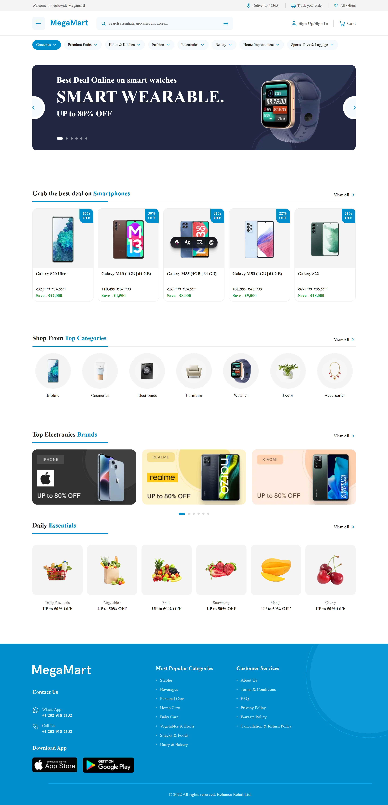

# MegaMart

MegaMart — это адаптивная страница интернет-магазина (лендинг), разработанная с использованием современного стек-технологий для обеспечения высокой скорости загрузки и удобства пользования.


_Адаптивный лендинг интернет-магазина на Astro + TypeScript_

---

## 🛠️ Стек

- **[Astro](https://astro.build/)** — статический генератор сайтов
- **Vanilla CSS** — без препроцессоров и фреймворков
- **CSS Custom Properties** — переменные для дизайн-токенов
- **TypeScript** — типизация в `.astro` и `.ts`
- **Vite** — сборщик (идёт с Astro)

---

## 📋 Требования

- **Node.js** ≥ 18.17.1
- **npm** ≥ 9

Проверь версии:

```bash
node -v
npm -v
```

---

## 🚀 Быстрый старт

```bash
# 1. Клонировать репозиторий
git clone https://github.com/VladimirKaz/MegaMart

# 2. Перейти в папку
cd template-astro

# 3. Установить зависимости
npm install

# 4. Запустить dev-сервер
npm run dev
```

Сайт откроется на **http://localhost:4321**

---

## 📜 Скрипты

| Команда           | Что делает                          |
| ----------------- | ----------------------------------- |
| `npm run dev`     | Запуск dev-сервера с hot-reload     |
| `npm run build`   | Сборка сайта в `dist/`              |
| `npm run preview` | Локальный просмотр собранного сайта |
| `npm run astro`   | Прямой доступ к CLI Astro           |

---

## 📁 Структура проекта

```text
MegaMart/
├── .astro/                  # Служебная папка Astro (генерируется автоматически)
├── .vscode/                 # Настройки редактора
├── figma-data/              # Исходники дизайна (макеты)не входят в сборку
├── node_modules/            # Зависимости проекта
├── public/                  # Статика (копируется в сборку как есть)
│   ├── favicon.svg
│   └── ...
├── scripts/                 # Вспомогательные скрипты (если есть)
│
├── src/
│   ├── assets/              # Ресурсы для оптимизации (импортируются в код)
│   │   ├── icons/           # SVG-иконки
│   │   └── images/          # Картинки контента
│   │
│   ├── components/          # Переиспользуемые компоненты
│   │   ├── icons/           # Компоненты иконок (если обернуты в .astro)
│   │   ├── layout/          # Глобальные части (Header, Footer)
│   │   ├── sections/        # Секции страниц (Hero, Categories, Products)
│   │   ├── ui/              # UI-кирпичики (Button, Card, Badge)
│   │   ├── vue/             # vue компоненты
│   │   │   └── sliders      # Все слайдеры
│   │   └── SEO.astro        # Компонент для мета-тегов
│   │
│   ├── content/             # Astro Content Collections (данные с валидацией)
│   │   ├── brands/          # Коллекция брендов (.md)
│   │   └── products/        # Коллекция товаров (.md)
│   │
│   ├── data/                # Статические данные (без валидации)
│   │   ├── hero-slider/     # Слайдер для секции Hero
│   │   └── navigation.ts    # Пункты меню и футера
│   │
│   ├── layouts/             # Шаблоны страниц
│   │   └── BaseLayout.astro # Основной лейаут (Head, Body, подключение стилей)
│   │
│   ├── pages/               # Роутинг (страницы)
│   │   ├── 404.astro        # Страница "Не найдено"
│   │   └── index.astro      # Главная страница (лендинг)
│   │
│   ├── stores/              # Корзина и авторизация
│   │
│   ├── types/               # Типы для корзины и авторизации
│   │
│   ├── styles/              # Архитектура CSS
│   │   ├── base.css         # Базовые стили тегов
│   │   ├── fonts.css        # Подключение шрифтов (@font-face)
│   │   ├── global.css       # Точка входа (импортирует все остальные)
│   │   ├── reset.css        # Сброс браузерных стилей
│   │   ├── tokens.css       # Дизайн-токены (CSS-переменные)
│   │   └── utilities.css    # Утилитарные классы (.container и т.д.)
│   │
│   └── content.config.ts    # Схема (Zod) и конфигурация Content Collections
│
├── .env                     # Переменные окружения (секреты)
├── .gitignore               # Исключения для Git
├── AGENTS.md                # Конфигурация для ИИ-ассистентов (служебный)
├── CLAUDE.md                # Конфигурация для Claude (служебный)
├── astro.config.mjs         # Конфигурация Astro (алиасы, интеграции)
├── package-lock.json        # Лок-файл зависимостей
├── package.json             # Зависимости и скрипты
├── README.md                # Документация проекта
└── tsconfig.json            # Конфигурация TypeScript (алиасы путей)
```

---

## 🦾 Типизация (TypeScript)

Проект полностью типизирован. Интерфейсы для данных лежат в `src/data/` или `src/content`.

Пример интерфейса пропсов в компоненте `.astro`:

````typescript
interface Props {
  title: string;
  items: Array<{ id: number; name: string }>;
}

const { title, items } = Astro.props;

---

## 🎨 Стили

Архитектура стилей — **простая и модульная**:

| Файл | Назначение |
|---|---|
| `tokens.css` | Дизайн-токены (цвета, отступы, размеры) |
| `reset.css` | Сброс браузерных стилей |
| `base.css` | Стили тегов (`h1`, `p`, `body`) |
| `utilities.css` | Утилиты и `.container` |
| `global.css` | Точка входа, импортирует всё выше |
| `fonts.css` | Стили для шрифтов и импорты

**Порядок импортов в `global.css` — важен!**

```css
@import './tokens.css';      /* 1. Переменные */
@import './reset.css';       /* 2. Сброс */
@import './fonts.css';       /* 3. Шрифты */
@import './base.css';        /* 4. База */
@import './utilities.css';   /* 5. Утилиты */
````

### Где менять цвета и размеры

Все **дизайн-токены** — в `src/styles/tokens.css`:

```css
:root {
  --color-primary: #4f46e5;
  --container-width: 1200px;
  --space-4: 1rem;
  /* ... */
}
```

Меняешь здесь — меняется **везде** в проекте.

### Правила именования классов

- **BEM-подобный** синтаксис: `.block__element--modifier`
- Пример: `.header__logo`, `.card__title`, `.btn--primary`

---

## 📱 Адаптивность

Верстка построена по принципу **Desktop First** .

- Основной контейнер ограничен `--container-width: 1200px`.
- Сетки товаров перестраиваются с 5 колонок на десктопе до 1–2 колонок на мобильных устройствах.
- Шрифты и отступы масштабируются через CSS-переменные в `tokens.css`.

---

## 🧩 Компоненты

### Структура компонента

```astro
---
// 1. Импорты
import Something from '@/components/Something.astro';

// 2. Пропсы
interface Props {
  title: string;
}

const { title } = Astro.props;
---

<!-- 3. Разметка -->
<div class="component">
  <h2>{title}</h2>
  <slot />
</div>

<style>
  /* 4. Стили (scoped по умолчанию) */
  .component {
    /* ... */
  }
</style>
```

### Что куда класть

| Что                               | Куда                      |
| --------------------------------- | ------------------------- |
| UI-кирпич (Button, Icon)          | `src/components/ui/`      |
| Блок страницы (Hero, Features)    | `src/components/sections` |
| Глобальные части (Header, Footer) | `src/components/layout`   |
| Layout                            | `src/layouts/`            |
| Страница                          | `src/pages/`              |

---

## 🔗 Алиасы путей

Настроены алиасы для удобных импортов:

| Алиас | Куда ведёт |
| ----- | ---------- |
| `@/`  | `src/`     |

**Примеры:**

```js
import Button from "@/components/ui/Button.astro";
import BaseLayout from "@/layouts/BaseLayout.astro";
import "@/styles/global.css";
import { site } from "@/data/site";
```

**Настройка — в двух файлах:**

- `tsconfig.json` — для VS Code
- `astro.config.mjs` — для сборщика Vite

---

## 🖼️ Работа с графикой

| Что                           | Куда                 | Как использовать                     |
| ----------------------------- | -------------------- | ------------------------------------ |
| Favicon, og-image, robots.txt | `public/`            | Прямой URL: `/favicon.svg`           |
| Локальные шрифты              | `public/fonts/`      | `/fonts/Inter.woff2`                 |
| Картинки контента             | `src/assets/images/` | `import img from '@/assets/images/'` |
| Иконки SVG                    | `src/assets/icons/`  | `import icon from '@/assets/icons'`  |

**Правило:** если нужен **прямой URL** → `public/`. Если **оптимизация** → `src/assets/`.

---

## 📊 Данные

Статические данные проекта — в `src/data/`:

```ts
// src/data/site.ts
export const site = {
  name: "MyProject",
  description: "...",
  email: "hello@example.com",
};

// src/data/navigation.ts
export const navigation = [
  { href: "/", label: "Главная" },
  { href: "/about", label: "О нас" },
];
```

**Использование в компонентах:**

```astro
---
import { site } from '@/data/site';
---
<a href="/" class="header__logo">{site.name}</a>
```

---

## 📦 Контент (Astro Content Collections)

Для управления товарами и брендами используется встроенный в Astro механизм **Content Collections**. Это позволяет хранить данные в Markdown-файлах и получать к ним доступ с полной типизацией.

### Структура контента

```text
src/
├── content/
│   ├── config.ts          # Схема (Zod) для валидации данных
│   ├── brands/            # Коллекция брендов
│   │   └── apple.md
│   └── products/          # Коллекция товаров (смартфоны)
│       ├── galaxy-s20.md
│       ├── galaxy-s22.md
│       ├── galaxy-m13.md
│       ├── galaxy-m33.md
│       └── galaxy-m53.md
```

---

## 🛒 Логика работы корзины (Cart Logic)

В проекте реализована полноценная интерактивная корзина, работающая по принципу SPA внутри статического сайта. Для этого успешно применена архитектура **Astro Islands** в связке с **Vue 3**.

### 🏗 Архитектура и стейт-менеджмент
* **Инкапсуляция:** Вся логика корзины изолирована в Vue-компонентах («островах»), которые загружаются независимо от основного контента страницы:
  * `CartButton.vue` — кнопка в хедере с иконкой и бейджем (счетчиком) количества товаров.
  * `CartDrawer.vue` — выдвижная панель (drawer) со списком добавленных товаров.

* **Глобальное состояние (Nano Stores):** Для синхронизации состояния между независимыми Vue-компонентами использована легковесная библиотека **Nano Stores**.
  * `cartItems` — объект с товарами (ключ — ID товара, значение — данные + количество).
  * `isCartOpen` — атомарное состояние для управления видимостью выдвижной панели.

* **Типизация (TypeScript):** Строго типизированы сущности `Product` и `CartItem`.

### ⚙️ Реализованный функционал
* **Добавление товаров:** Из карточек товаров (Vue-компоненты / `.astro`-файлы) данные передаются в глобальный стор.
* **Управление количеством:** Методы `addToCart` (увеличение) и `decrementQuantity` (уменьшение). Если количество опускается до нуля, товар автоматически удаляется из корзины.
* **Удаление товаров:** Метод `removeFromCart` для полного удаления позиции.
* **Реактивный подсчет:** Вычисление общей суммы (`totalPrice`) и общего количества товаров (`totalItems`) на основе `computed` свойств Vue.
* **Сохранение в localStorage:** Состояние корзины сохраняется в `localStorage` с помощью хука `onSet` из Nano Stores. Используется безопасная проверка на наличие объекта `window`, чтобы избежать ошибок при серверном рендеринге (SSR).
* **UI/UX:** 
  * Плавная CSS-анимация выезда панели (`transition: transform`).
  * Overlay (затемнение) фона с возможностью закрытия корзины по клику.
  * Визуальный фидбек (hover-эффекты, бейджики).
  * Пустое состояние корзины (Empty State).

## 🔐 Модальное окно авторизации (Auth Modal)

Для реализации входа и регистрации без перезагрузки страницы был создан интерактивный Vue-«остров», управляемый через глобальное состояние.

### 🏗 Архитектура и стейт-менеджмент
* **Глобальное состояние (`auth.ts`):** 
  * `user` — атомарное состояние с данными пользователя.
  * `isAuthOpen` — управляет видимостью модального окна.
  * `authMode` — переключатель между режимами `login` и `register` (вкладки внутри модалки).

### ⚙️ Реализованный функционал и UI/UX
* **Единая точка входа:** Кнопка `UserButton.vue` в хедере открывает модалку. Если пользователь авторизован, кнопка показывает его имя, если нет — призыв «Sign Up/Sign In».
* **Форма с переключением режимов:** Внутри модалки реализованы две вкладки (Вход/Регистрация). В зависимости от выбранного режима, форма динамически меняет поля (например, появляется поле «Имя» при регистрации).
* **Анимация без `<Transition>`:** Вместо встроенного Vue-компонента `<Transition>`, который часто вызывает конфликты при гидратации в Astro, была использована нативная CSS-анимация (`@keyframes fadeIn` и `slideUp`). Это гарантирует стабильность работы интерфейса.
* **Хранение сессии:** После успешного «входа» (заглушки, имитирующей API), данные пользователя записываются в `localStorage` и подтягиваются при перезагрузке страницы. Также реализована функция `logout`.

### 💡 Ключевые челленджи, которые были решены

1.  **Синхронизация состояния вне Vue-дерева:** Обычные пропсы/events не работают между разными «островами» Astro. Переход на Nano Stores решил эту проблему без подключения тяжелого Pinia.
2.  **Передача данных из Astro в Vue:** Передача оптимизированных картинок (`ImageMetadata` из Astro Content Collections) через `data-атрибуты` в статичных карточках для последующей обработки в Vue.
3.  **Типизация динамических ключей:** Настройка TypeScript для корректной работы с объектами-словарями (`Record<string, ...>`), где ID товаров из Markdown приходят строками.

### 🎠 Hero Slider (Слайдер баннера)

Для секции Hero реализован кастомный слайдер с плавной анимацией переключения.

**Архитектура:**
Слайдер разделен на три части для удобства поддержки:
1. **Данные (`src/data/heroSlides.ts`)** — массив объектов с контентом. Содержит заголовок, подзаголовок, описание, картинку товара и alt-текст. Чтобы добавить новый слайд, достаточно добавить новый объект в этот массив.
2. **Компонент (`src/components/vue/sliders/HeroSlider.vue`)** — Vue-компонент, который отвечает за логику переключения, анимации и верстку. Принимает массив данных и картинку декора через props.
3. **Сборка (`src/components/sections/HeroSection.astro`)** — связывает данные и компонент, подготавливает пути к картинкам (извлекает `.src`) и передает их в Vue.

**Особенности реализации:**
*   **Навигация:** Переключение слайдов происходит по клику на стрелки (по бокам баннера) или на точки внизу.
*   **Анимация:** Используются встроенные компоненты Vue `<Transition>` для плавной смены текста (`fade`) и картинки (`slide-fade`).
*   **Адаптивность:** На мобильных устройствах баннер перестраивается в колонку (картинка сверху, текст снизу), а стрелки перемещаются вниз.
*   **Декор:** Фоновая картинка (круги) является статичной и не участвует в анимации смены слайдов.


---

## 🎯 Соглашения

### Именование файлов

- **Компоненты** — `PascalCase`: `Button.astro`, `Header.astro`
- **Утилиты и данные** — `camelCase`: `site.ts`, `navigation.ts`
- **Стили** — `kebab-case` или `camelCase`: `tokens.css`, `global.css`
- **Страницы** — `kebab-case`: `about-us.astro`, `contact.astro`

### CSS-классы

- **BEM-подобный**: `.block__element--modifier`
- **Утилиты** — короткие: `.container`, `.text-center`

### Порядок стилей в компоненте

1. Позиционирование (`position`, `top`, `z-index`)
2. Блочная модель (`display`, `width`, `padding`)
3. Типографика (`font`, `color`, `text-align`)
4. Визуал (`background`, `border`, `box-shadow`)
5. Анимации (`transition`, `transform`)

---

## 🔧 Полезные команды

```bash
# Проверка типов
npx astro check

# Установка нового пакета
npm i имя-пакета

# Установка dev-зависимости
npm i -D имя-пакета

# Очистка кэша (если что-то сломалось)
rm -rf node_modules .astro dist
npm install
````

---

## 📚 Полезные ссылки

- [Документация Astro](https://docs.astro.build/)
- [Astro в примерах](https://docs.astro.build/en/guides/examples/)
- [MDN — HTML, CSS, JS](https://developer.mozilla.org/)
- [Can I use](https://caniuse.com/) — поддержка CSS-фич
- [CSS Tricks](https://css-tricks.com/) — статьи и советы

---

## 📄 Лицензия

MIT — используй свободно.

---

## 📞 Контакты

- **Автор:** Владимир Казаков
- **Телеграмм** [@VladimirKaz](https://t.me/Ka3Vladimir)
- **GitHub:** [@VladimirKaz](https://github.com/VladimirKaz)
